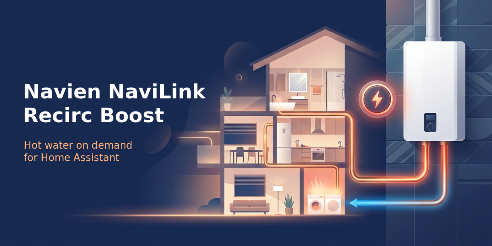

# Navien NaviLink Recirc Boost

A Home Assistant integration (installed with HACS, the Home Assistant Community Store) for **Navien NaviLink**,
Navien's cloud service behind the NaviLink phone app. It does not connect to the water heater directly: it signs in
to your NaviLink account and sends commands through NaviLink, so your heater must already be set up in the NaviLink
app.

It is made for Navien tankless heaters that run their recirculation pump on the heater's own **weekly schedule**,
such as the NPE-2 series. In schedule mode these heaters ignore NaviLink's "Hot Button". Navien NaviLink Recirc Boost gives
you a **Boost** button that heats the hot-water loop anyway, then puts your schedule back exactly as it was.

### What a boost does
1. Reads the heater's current weekly schedule (so it can be restored exactly).
2. Turns the schedule off. The recirculation pump starts and the burner heats the loop.
3. Watches the water returning to the heater until it is within the **stop offset** of the heater's target
   temperature (default 5 degrees; for example 125 °F when the heater is set to 130 °F).
4. Runs **extra minutes** (default 2), never longer than the **safety cap** (default 15 minutes in total).
5. Turns the schedule back to how it was, retrying up to 4 times. If that fails you get a Home Assistant
   notification. If Home Assistant restarts during a boost, the schedule is restored when it starts again.

### What you get
| Entity | What it is |
| --- | --- |
| Boost (button) | Start a boost |
| Stop boost (button) | Finish a boost early (the schedule is still restored) |
| Boost running (binary sensor) | On during a boost; attributes show the phase and stop temperature |
| Schedule (sensor) | On/off, with one attribute per day, e.g. `monday: 06:00-08:00, 17:30-21:00`. Read at startup and hourly |
| Weekly schedule (switch) | Turn the heater's own schedule on or off (its windows are kept) |
| Target temperature (number) | The heater's set temperature |
| Boosts today, Boosts total, Last boost (sensors) | Boost tracker; kept across restarts. "Today" resets at midnight |
| Return water temperature, Outlet temperature (sensors) | Water coming back to / leaving the heater |
| NaviLink connected (binary sensor) | Cloud connection status |
| Boost 1 · Stop this close to target, Boost 2 · Extra run once hot, Boost 3 · Never run longer than (numbers) | The boost settings, under **Configuration** on the device page. A boost stops when the return water is within the first setting of the heater's target (e.g. 5 °F), keeps going for the extra minutes, and never runs past the third |
| Schedule 1 · Sunday ... Schedule 7 · Saturday (text) | Each day's hot-water times, under **Configuration** on the device page. Type e.g. `6am-8am, 5:30pm-9pm`, `06:00-08:00`, or `off` (up to 4 windows a day); it's sent to the heater when you press Enter |

Actions (services) for automations: `navien_recirc_boost.boost` (optionally override the stop offset, extra minutes and
safety cap), `navien_recirc_boost.stop_boost`, `navien_recirc_boost.refresh_schedule`, and
`navien_recirc_boost.set_day_schedule` (e.g. `day: monday`, `windows: "06:00-08:00, 17:30-21:00"`, or `off`), and
`navien_recirc_boost.set_week_schedule` (any days at once, e.g. `tuesday: "06:00-08:00"`, `saturday: "off"`, plus an
optional `enabled` to turn the schedule on or off).

### Schedule card
The integration adds a dashboard card, so there is nothing else to install. Edit a dashboard > Add card >
**Navien hot water schedule** (or add `type: custom:navien-schedule-card` in YAML).

- One row per day across 24 hours. Drag across a row to turn hot water on, drag over orange to turn it off.
  Drag down across rows to set several days at once. Up to 4 windows a day.
- A switch in the corner turns the heater's schedule on or off.
- Press **Save** to send the changed days to the heater in one go, or **Discard** to start over.
- Options: `entity` (the Schedule sensor; found on its own), `title`, `step` (15, 30 or 60 minutes per cell, default 30),
  `first_day` (`sunday` or `monday`).

Days you don't touch keep their exact times, even if they don't line up with the grid.

### Install
1. In HACS: ⋮ > Custom repositories > add `https://github.com/kdttocs/navien-recirc-boost`, type **Integration**.
2. Download **Navien NaviLink Recirc Boost**, then restart Home Assistant.
3. Settings > Devices & services > Add integration > **Navien NaviLink Recirc Boost**, and sign in with your NaviLink
   app email and password.

### Remove
Settings > Devices & services > Navien NaviLink Recirc Boost > ⋮ > Delete, then remove it in HACS and restart Home Assistant.
If a boost is running, stop it first so your schedule is restored.

### Settings
The easiest way is the device page (Settings > Devices & services > Navien NaviLink Recirc Boost > your heater), whose
**Configuration** section has the three boost settings and one schedule row per day, or the schedule card above.
They can also be changed under Settings > Devices & services > Navien NaviLink Recirc Boost > **Configure**:
- **Boost settings**: stop offset (degrees below target, e.g. 3, 4, 5), extra run time, safety cap.
- **Weekly schedule**: shows the heater's whole week as read from the heater, one line per day, plus a
  Schedule on switch. Edit any day (24-hour clock, up to 4 windows like `06:00-08:00, 17:30-21:00`, or `off`)
  and submit; only the days you changed are sent to the heater, right away.

### Notes
- It signs in to NaviLink on its own and does not need any other Navien integration. It can run alongside
  another NaviLink integration; each connection uses its own random client ID.
- Don't run two boost controllers at once (for example an older script that also toggles the schedule).
- Tested against an NPE-2 (NaviLink device type 2). Setting a day to `off` and windows on minutes other than
  :00/:30 have not been tried on a real heater yet.

### Disclaimer
Not made by or affiliated with Navien. This integration uses NaviLink's unofficial, undocumented cloud interface, which Navien may change at any time. It needs an internet connection and a working NaviLink account.

### Credits
The NaviLink sign-in and messaging code in `custom_components/navien_recirc_boost/navilink/` comes from
[lasswellt/navien-homeassistant](https://github.com/lasswellt/navien-homeassistant) (MIT License); see
`custom_components/navien_recirc_boost/NOTICE`.

Developer tests: `pip install pytest-homeassistant-custom-component paho-mqtt`, then
`PYTHONPATH=. pytest tests -o asyncio_mode=auto`.
